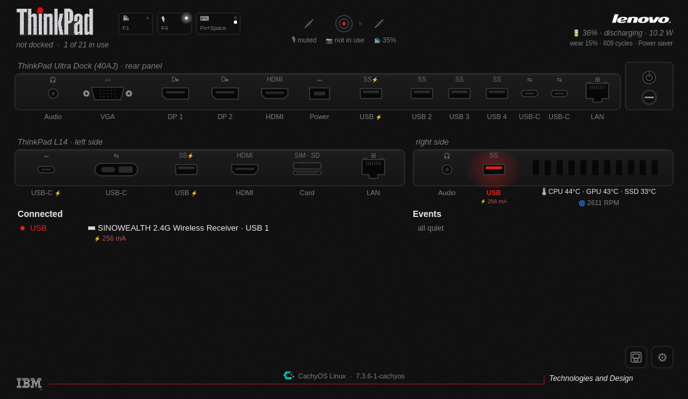
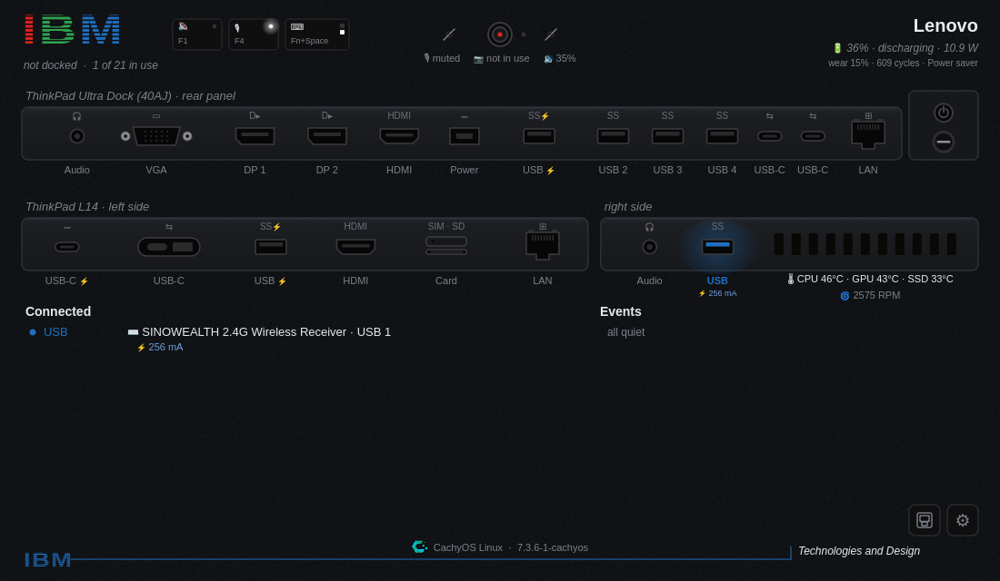
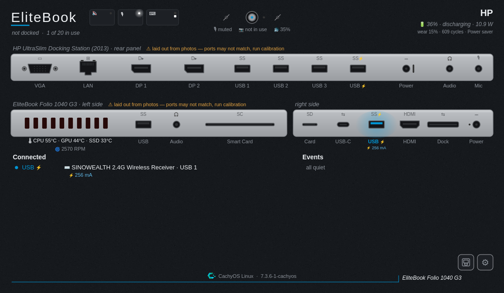
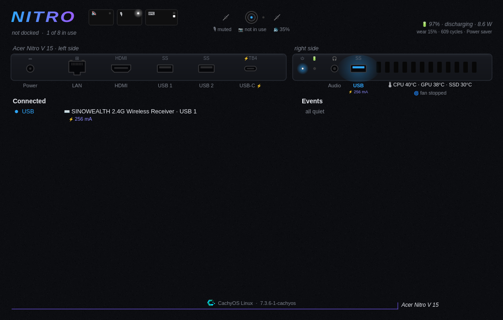
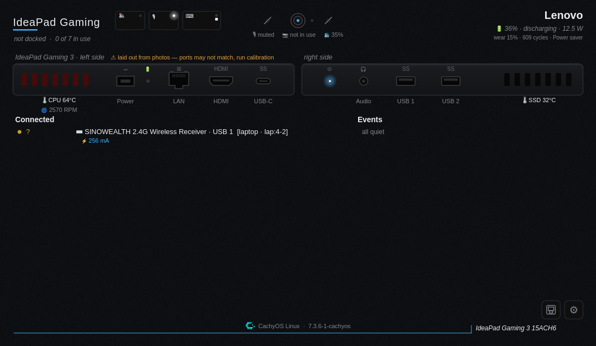

# DockWatch

Live port map of your **docking station and laptop**, in ThinkPad style. It shows which connectors are in use,
what is plugged into each one, how much power and bandwidth it takes, and pops up a notification on plug/unplug.



| IBM theme | Light theme |
|---|---|
|  |  |

Other laptops (profiles made from photos):

| HP EliteBook Folio 1040 G3 | Acer Nitro V 15 | Lenovo IdeaPad Gaming 3 15ACH6 |
|---|---|---|
|  |  |  |

Screenshots in other languages: [українська](docs/screenshot-uk.png) · [русский](docs/screenshot-ru.png)

**Languages:** українська · русский · English (auto from `$LANG`; switch in the menu or with `--lang`).

## Features
- Real port layout of the dock (rear panel) and the laptop sides; connectors glow red when in use.
- Per port: device name, USB speed, declared current, **disk read/write and network speed** with a one-minute sparkline,
  USB-C **Power Delivery** role and current, LAN speed and traffic.
- Phones: detects the USB mode (MTP file transfer, PTP, ADB, tethering, MIDI).
- SD card slot, 3.5 mm jack (headphones / headset), HDMI/DP/VGA monitors (name from EDID, resolution, refresh rate
  and scale from KDE / Hyprland / wlroots / X11).
- **Slow USB warning**: a USB 3 device that only got USB 2 speed (USB 2 port, bad cable or adapter) is marked ⚠.
- **Alerts** (can be turned off in Settings): running hot (threshold in Settings), charger connected but the battery is
  draining (weak adapter or cable), battery low, slow USB, laptop docked but the dock has no power.
- Header: camera and microphones state (in use by which app, muted), F1/F4 mute LEDs, sound volume,
  battery level, wear and cycles, power profile, Wi‑Fi network, connected Bluetooth devices with battery.
- Temperatures (CPU/GPU/SSD, NVIDIA via `nvidia-smi`) and fan RPM under the vent grille, which glows as the laptop heats up;
  with two grilles each one can show its own chip (e.g. CPU on the left, GPU on the right).
- Status LEDs on the case (power, charging — with the real colours, e.g. red below 90 %, white when full).
- Right-click a port with a drive: **open** it or **safely remove** it.
- "Don't forget your flash drive" reminder when you undock or close the lid with a drive still mounted.
- Connection log (`~/.local/share/dockwatch/history.log`), start at login, power profile switching.
- ThinkPad extra: blink the red dot on the lid when something is plugged in (needs a small udev rule).
- A USB-C that is also the dock connector is shown as USB-C when undocked and as the dock when docked.
- **Settings window**: language, theme, scale, sound, animations, options; rename ports; give your own names to devices
  (recognised by serial number — right-click a port → *Rename device*).
- **Themes**: ThinkPad (black, red), IBM (red/green/blue accents and the striped IBM logo), Light (white ports and keys),
  plus brand themes picked automatically: Lenovo, Legion, ASUS / ROG, Dell / Alienware, HP / OMEN, Acer / Nitro, MSI,
  Razer, Samsung, Huawei, Xiaomi, Gigabyte, Framework, Apple.
- **Any laptop**: without a profile DockWatch builds a layout itself from `/sys` (USB / USB-C, HDMI, LAN, jack,
  card reader, camera) and picks the brand theme; `dockwatch make-profile` saves it as JSON to refine.
- **Layout editor** (menu → *Edit layout*): drag ports along a side or to another side, right-click to change the type,
  rename, add or delete; saved to `~/.config/dockwatch/profiles`.
- Settings button (⚙) in the bottom-right corner of the window.
- Smooth glow when a port lights up, a short chime on plug/unplug (can be turned off).
- **Plasma 6 panel widget**: dock icon with the number of busy ports, click for the list (installed by `install.sh`;
  right-click the panel → Add Widgets → DockWatch).
- `dockwatch json` — machine-readable state for scripts and widgets.

## Views
| Command | What it does |
|---|---|
| `dockwatch` | window + tray icon; closing the window keeps it in the tray, a second launch just shows the window |
| `dockwatch tray` | start hidden in the tray (used for autostart) |
| `dockwatch gui` | window only |
| `dockwatch tui` | terminal version (curses) |
| `dockwatch dump` | plain-text state |
| `dockwatch calibrate` | bind system USB ports to physical connectors in the terminal (in the window: menu → *Calibrate ports* — the port to use glows, plug anything in, click to skip) |
| `dockwatch report` | collect everything needed for a new laptop profile into `~/dockwatch-report-<model>.tar.gz` (no serial numbers, user or host names) — also in the menu |
| `dockwatch make-profile` | print a profile of this laptop (auto layout) as JSON |
| `dockwatch json` | machine-readable state for scripts and widgets |

## Install
```sh
git clone https://github.com/Watashik/DockWatch && cd DockWatch
./install.sh               # `dockwatch` command, menu entry and icon (per user, no root)
./install.sh --autostart   # same + start in the tray at login
sudo ./install-root.sh     # optional: allow blinking the ThinkPad lid dot
```
Arch/CachyOS: an AUR `PKGBUILD` is in `packaging/aur/`.

Fedora:
```sh
sudo dnf install python3-pyside6 pulseaudio-utils udisks2 bluez
# KDE Plasma: the tray icon and the panel widget work out of the box.
# GNOME: install the "AppIndicator and KStatusNotifierItem Support" extension for the tray icon.
```
On Fedora regular users are not in the `users` group, so for the lid-dot blink also run `sudo usermod -aG users $USER`.

Requirements: Python 3, PySide6 (`sudo pacman -S pyside6`). Optional: udisks2, pactl (PipeWire/PulseAudio),
NetworkManager, bluez-utils, power-profiles-daemon. Only `/sys` and these user-level tools are used — no root.

## Supported hardware
| Type | Model | Profile |
|---|---|---|
| Dock | Lenovo ThinkPad Ultra Docking Station (40AJ) | `profiles/docks/lenovo-thinkpad-ultra-dock-40aj.json` |
| Dock (draft) | Lenovo ThinkPad Pro Dock (40AH) | `profiles/docks/lenovo-thinkpad-pro-dock-40ah.json` |
| Dock (draft) | Lenovo ThinkPad Basic Dock (40AG) | `profiles/docks/lenovo-thinkpad-basic-dock-40ag.json` |
| Dock (draft) | Lenovo ThinkPad USB-C Dock Gen 2 (40AS) | `profiles/docks/lenovo-thinkpad-usb-c-dock-gen2-40as.json` |
| Dock (draft) | Dell WD19 | `profiles/docks/dell-wd19.json` |
| Dock | HP UltraSlim Docking Station (2013) | `profiles/docks/hp-ultraslim-dock-2013.json` |
| Laptop | Lenovo ThinkPad L14 Gen 1 | `profiles/laptops/lenovo-thinkpad-l14-gen1.json` |
| Laptop | Lenovo IdeaPad Gaming 3 15ACH6 | `profiles/laptops/lenovo-ideapad-gaming-3-15ach6.json` |
| Laptop | HP EliteBook Folio 1040 G3 | `profiles/laptops/hp-elitebook-folio-1040-g3.json` |
| Laptop | Acer Nitro V 15 (ANV15-51) | `profiles/laptops/acer-nitro-v15-anv15-51.json` |
| Laptop | anything else | auto layout (see *Any laptop* above) |

Only the ThinkPad L14 + 40AJ pair is verified on real hardware (`"verified": true`); for every other profile the window shows a compatibility warning next to its title until you calibrate it; the other laptops are laid out from photos and need
`dockwatch calibrate` once. *Draft* profiles are made from spec sheets and not verified on real hardware; they are only selectable manually in the menu until someone confirms them.

Docks are detected by the VID:PID of their internal USB hubs, laptops by DMI; both can be chosen manually in the menu.

### Adding your dock or laptop
Profiles are plain JSON — copy an existing one:
- `match` — detection: `usb_hubs` (VID:PID of the dock's hubs, see `lsusb`) or `dmi` (substring of `/sys/class/dmi/id/product_version`).
- `groups` — physical sides; `row` + `w` put several on one line; `vents` draws a grille with sensors (`"sensors": {"temps": ["CPU"], "fans": [0]}` gives each grille its own — e.g. CPU on the left, `dGPU`/SSD on the right); `bezel` enables the camera/mic header.
- `ports` — connectors left→right: `kind` (`usb`, `usbc`, `hdmi`, `dp`, `minidp`, `microhdmi`, `vga`, `rj45`, `audio`,
  `dc`, `barrel`, `barrel_led`, `barrel_dot`, `card`, `sdslot`, `sim`, `smartcard`, `dockport`, `sidedock`, `lock`, `led`),
  `x` — centre as a fraction of the side width, `label`, optional `role` (`power`, `eth`, `dock`, `card`, `jack`, `usb_audio`),
  `label_docked`, `typec` (e.g. `port0`) and `drm` (e.g. `["HDMI-A-1"]`).
  LEDs: `"led": "power"` or `"charge"`, optional `"led_colors": {"low": "#ff3b30", "full": "#ffffff", "full_at": 90}`.
- `theme`, `brand` (header wordmark), `footer` — looks.

Check it with `python tools/check_profiles.py` (also run by GitHub Actions on every push), then run `dockwatch calibrate` once. New profiles are welcome — open an issue with the **New dock / laptop profile** form
(photos of the sides + the archive from `dockwatch report`).

## Plugins
Drop a `*.py` into `~/.local/share/dockwatch/plugins/`. A plugin may define `TR` (translations), `CLI` (extra commands),
`on_start(ctx)`, `on_tick(state, events, ctx)` and `menu(add, ctx)`; the DockWatch module is available as `dw`.

## Config
`~/.config/dockwatch/config.json` — port bindings, custom labels, language, chosen profiles, options.

## Logos
`assets/` may contain `thinkpad.png`, `lenovo.png`, `ibm.png` for the header/footer. They are trademarks of their owners
and are **not** distributed with the project; without them a drawn wordmark is used (as on the screenshot).

## License
MIT
